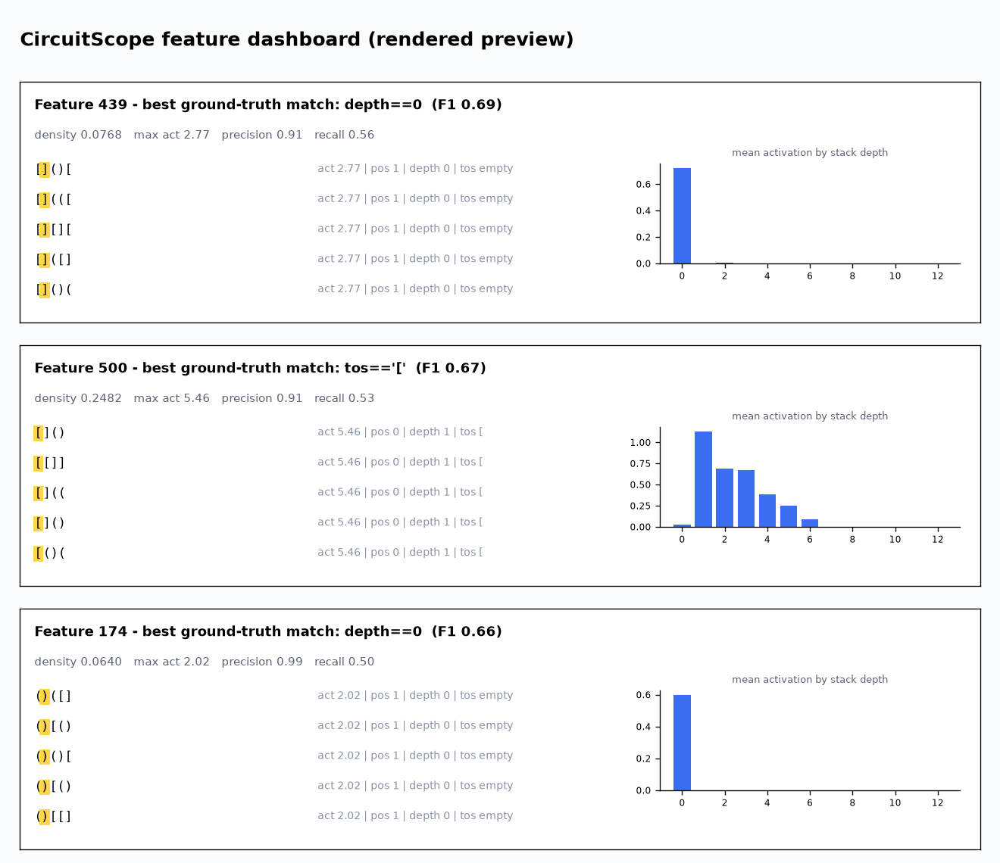
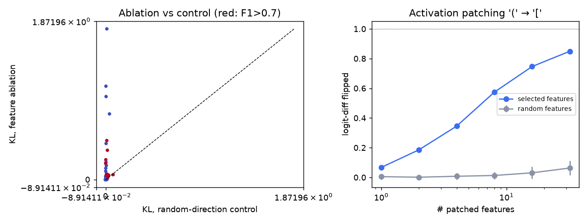
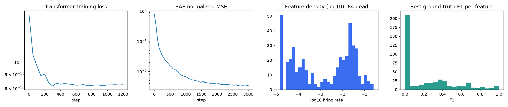

# CircuitScope: Fast Sparse Autoencoders with a C++ Kernel for Interpretability

Train sparse autoencoders (SAEs) on a small transformer's activations to find interpretable features, verify them with causal interventions, and speed up training with a custom C++ top-k kernel.

Everything runs locally on CPU in about ten minutes, with no services, data downloads or secrets.



*Top three cards of the generated `artifacts/dashboard.html`, rendered to PNG with matplotlib from the same data (`plots/dashboard_preview.png`). It is not a browser screenshot, because the build environment had no browser. The real dashboard is a static HTML page with these cards for 120 features.*

**At a glance** (reference run, 1 CPU core): C++ kernel **up to 5.7x faster** per SAE training step and 30–42% less peak memory; **54% (21/39)** of ground-truth variables recovered as a single feature at F1 ≥ 0.7 (33% at F1 ≥ 0.9); causally verified by ablation and patching. The structural-recovery caveat is in [Recovery rate](#recovery-rate-ground-truth-features).

## Features

- **Transformer with known ground truth.** A 2-layer, d=64 transformer is trained from scratch on next-token prediction for **Dyck-2** (two bracket types, length-24 balanced strings). The generator is a known policy, so the *exact* next-token distribution and the latent variables (stack depth, top-of-stack type, position) are available for every prefix. The transformer reaches a validation KL of 2e-4 to the exact distribution and 100% legal argmax predictions.
- **Top-k SAE trainer** on residual-stream activations. It uses a unit-norm decoder, gradient projection and dead-feature resampling, and supports two backends: pure PyTorch and a C++17/OpenMP kernel (heap top-k plus sparse decode forward and backward), validated against the PyTorch reference.
- **Feature analysis.**
  - Top-activating examples.
  - A static HTML dashboard (`artifacts/dashboard.html`) with each feature's best-matching ground-truth predicate (F1), density, and activation-by-depth bars.
  - A dead/rare/dense feature and reconstruction report, including *downstream* spliced-in loss versus zero/mean-ablation baselines.
- **Causal tests.**
  - *Ablation sweep.* Every alive feature is removed from the residual stream and compared against a norm-matched random-direction control.
  - *Activation patching.* Feature activations from a "top of stack is `[`" run are patched into a "top of stack is `(`" run, and we measure how much of the closing-bracket logit difference flips, against random feature sets of equal size.
- **Benchmark** of kernel speed and peak memory against the PyTorch path (each measurement in a fresh subprocess).

## Quick start

Requires Python ≥ 3.10, a C++17 compiler with OpenMP, and CMake.

```bash
python -m venv .venv && source .venv/bin/activate
pip install -r requirements.txt          # CPU torch is enough:  pip install torch --index-url https://download.pytorch.org/whl/cpu
cp .env.example .env                     # optional; every variable has a default (a `.env` in the working directory is read automatically)

make build                               # CMake -> circuitscope/_kernels*.so (C++ kernels)
make test                                # 24 pytest tests
make demo                                # train model + SAE, analyse, causal tests  (~5 min on 1 core)
make bench                               # kernel benchmark -> artifacts/benchmark.{md,json,png}
make live-demo                           # the 1-minute live demo (needs `make demo` first)
```

`python -m circuitscope all --quick` is a ~1 minute smoke run. Stages can also be run separately: `model`, `sae`, `analyze`. `--backend torch` forces the reference path. If the extension is not built, everything still works and falls back to PyTorch (kernel tests are skipped).

Outputs go to `artifacts/` (git-ignored): `dashboard.html`, `report.md`, `results.json`, `plots/*.png`, `model.pt`, `sae.pt`, and the benchmark files.

## Architecture

```
csrc/kernels.cpp          OpenMP kernels: topk_rows, sparse_decode, sparse_decode_backward (pybind11)
CMakeLists.txt            builds the extension into circuitscope/
circuitscope/
  data.py                 Dyck-2 sampler with exact next-token distributions + ground-truth labels
  model.py                tiny transformer with resid(layer) / forward_from(resid, layer) split + trainer
  kernels.py              torch.autograd.Functions for top-k and sparse decode, "torch" vs "cpp" backends
  sae.py                  TopKSAE + trainer (Adam, dead-feature resampling)
  analysis.py             density, dead features, F1 matching to ground truth, reconstruction/downstream loss
  dashboard.py            static HTML dashboard + markdown report
  interventions.py        ablation sweep and activation patching on residual-stream features
  benchmark.py            subprocess-isolated speed/peak-RSS benchmark
  pipeline.py, cli.py     stages and `python -m circuitscope`
tests/                    kernel-vs-reference, SAE planted-feature recovery, data, interventions
docs/                     figures from a reference run
```

Data flow: sampler → transformer → residual activations at `CS_HOOK_LAYER` → top-k SAE → analysis, dashboard and interventions (which edit the residual stream and re-run the remaining transformer blocks).

## Results from a reference run (1 CPU core, seeded)

SAE: 512 features, k=8, trained on 276k residual vectors after block 1.

| metric | value |
|---|---|
| variance explained | 0.997 |
| downstream loss recovered (spliced SAE vs mean-ablation) | 0.9999 |
| dead features | 64 / 512 |
| features matching a ground-truth predicate with F1 > 0.9 / > 0.7 | 15 / 35 |
| ablation KL: feature vs random-direction control (mean over alive features) | 0.0195 vs 0.0011 |
| patching `(`→`[`: 8 selected features / 8 random / all features | 0.57 / 0.013 / 0.92 of the logit gap |




Honest reading of the results:
- Most well-matched features are **position-locked** (the model's positional signal is strong at this layer). Structural features (depth 0, top-of-stack `(` / `[`) exist but are weaker (F1 about 0.4–0.7 for top-of-stack). The dashboard lists structural matches first.
- The patching experiment is the clearest causal evidence: a handful of features selected by activation difference moves the closing-bracket decision, while random features of equal size do essentially nothing.
- The ablation "predicted effect" check (a top-of-stack feature's ablation should lower its matching closing bracket most) held for only 2 of 7 features. Ablating one feature of a distributed code is often compensated by the others, so this is reported rather than tuned away.
- Numbers vary a little between runs because of the activation sampling and resampling.

### Recovery rate (ground-truth features)

Because the task has known latents, recovery can be measured. The ground-truth set is the 39 predicates that occur in the data: `depth==0..12` (13), top-of-stack `(` / `[` / empty stack (3), and `pos==0..22` (23). A predicate is **recovered at threshold t** if some single SAE feature's activation matches it with F1 ≥ t (`analysis.recovery_rate`).

| | predicates | recovered, F1 ≥ 0.9 | recovered, F1 ≥ 0.7 |
|---|---|---|---|
| all | 39 | **33%** (13) | **54%** (21) |
| position (`pos==p`) | 23 | 57% (13) | 91% (21) |
| structural (depth, stack type) | 16 | 0% | 0% |

Read this honestly: the SAE cleanly recovers *where in the sequence* a token is, but not the stack depth or the top-of-stack bracket as a single feature. Those exist only as weaker, partial features (best structural F1 about 0.69, e.g. a `depth==0` feature with precision 0.91 but recall 0.56). The model very likely represents depth in a distributed or ordinal way that a k=8 code splits across features. The causal tests still show that such features matter (see below), and larger or differently-regularised SAEs are the obvious next experiment.

### Kernel benchmark (1 OpenMP thread, this machine)

| B | F | k | d | topk torch/cpp (ms) | decode torch/cpp (ms) | step torch/cpp (ms) | step speedup | peak extra MB torch/cpp |
|---|---|---|---|---|---|---|---|---|
| 4096 | 1024 | 8 | 64 | 13.46 / 12.49 | 32.32 / 0.46 | 104.7 / 40.8 | 2.57x | 103 / 60 |
| 4096 | 4096 | 16 | 128 | 56.36 / 39.51 | 170.92 / 1.70 | 522.8 / 160.2 | 3.26x | 224 / 157 |
| 4096 | 16384 | 32 | 256 | 223.03 / 126.41 | 971.97 / 11.03 | 2756.5 / 580.8 | 4.75x | 863 / 591 |
| 2048 | 32768 | 64 | 512 | 232.01 / 135.76 | 1338.88 / 38.74 | 4170.5 / 733.3 | 5.69x | 948 / 605 |

"step" is top-k → decode → loss → backward. The benchmark machine has **one core**, so these numbers show the algorithmic gain (decode touches B·k·d instead of B·F·d, and no dense B×F code matrix is built) but **not multi-core scaling**. The OpenMP parallelism is implemented and tested for correctness at 1 thread only here. Absolute numbers will differ on your hardware; run `make bench`.

## 1-minute live demo

```bash
make demo        # once: trains everything (~5 min on 1 core)
make live-demo   # ~50 s: python -m circuitscope demo   (--pace 1 to speed up, --no-open to skip the browser, --feature N to pick one)
```

The script narrates five steps:
1. Opens `artifacts/dashboard.html` in your browser (or prints the path when there is no display).
2. Picks the structural feature with the largest causal effect.
3. Picks its top-activating example from the dashboard.
4. **Ablates the feature live** on that sequence and prints the exact next-token distribution, the model's, the ablated model's and a random-direction control's side by side.
5. Repeats the ablation over 600 sequences and prints the patching result from the last run.

Real output from the reference run (feature 30, a top-of-stack-`(` feature, F1 0.41):

```
   position 7, after prefix '()()()[(':
   next token    exact   model   ablated   random-dir control
      (          0.25    0.25    0.41      0.23
      [          0.25    0.25    0.47      0.27
      )          0.50    0.50    0.12      0.49
      ]          0.00    0.00    0.00      0.00
   KL(clean || ablated) = 0.4449   vs   random-direction control = 0.0016
```

Removing one feature drops the probability of the matching closing bracket `)` from 0.50 to 0.12, while removing a random direction of the same norm changes nothing.

## Resume line

> Implemented SAE interpretability pipeline with custom C++ top-k kernel (up to 5.7x faster training step); recovered 54% of ground-truth features (F1 ≥ 0.7; 33% at F1 ≥ 0.9) and verified them causally.

The numbers are from the single-core reference run above. The 54% is dominated by positional features, and 0% of the structural features were recovered as single features, so quote the recovery figure together with that caveat.

## Key design decisions

- **Dyck-2 over modular arithmetic.** It trains in a couple of minutes on CPU (modular addition needs grokking-length runs) and gives an *exact* generative distribution. Features can therefore be scored against real latents, and model quality is a KL rather than a loss with unknowable entropy.
- **pybind11 + numpy buffers instead of a torch C++ extension.** Torch CPU tensors share memory with numpy, so the kernels receive raw pointers with zero copies. The extension compiles in seconds and needs no libtorch. The cost is CPU float32 only; the autograd wrappers live in Python.
- **Heap top-k.** Per row a size-k min-heap scans F entries; most fail the root comparison, so it is about O(F). Ties break toward the lower index, which makes the output deterministic and matches `torch.topk` on tie-free data (tested exactly).
- **Backward without atomics.** In `sparse_decode_backward`, thread *t* owns the features with `f % T == t`, so decoder gradients are deterministic for a fixed thread count and need no atomics or per-thread buffers.
- **Interventions are additive deltas** (`resid += Δa·d_i`), not swaps with the SAE reconstruction, so SAE error never contaminates the measured effect.
- **Dead-feature resampling with 0.2× encoder norm.** Resampling at full norm made the new features steal top-k slots and destabilised training (NMSE rose from 0.006 to 0.037 in testing).
- **Input scaling lives inside the SAE** (`scale` buffer), so decoder directions can be mapped back to residual units for interventions.
- `-march=native` is on by default for speed; configure with `-DCS_NATIVE=OFF` for a portable binary.

## Configuration

All settings are environment variables prefixed `CS_` (see `.env.example`): hook layer, SAE size, `k`, steps, seed, backend, output dir. No secrets are used anywhere.

## Tests

`make test` (or `pytest -q` after `make build`) covers:
- top-k exactness against `torch.topk`, tie handling and bad-`k` errors;
- sparse-decode forward and gradients against the dense reference;
- out-of-range index rejection and backend fallback;
- Dyck sampler validity and label consistency;
- the residual split of the transformer;
- SAE recovery of planted ground-truth directions (both backends) and backend equivalence;
- feature statistics, ablation and patching sanity.
